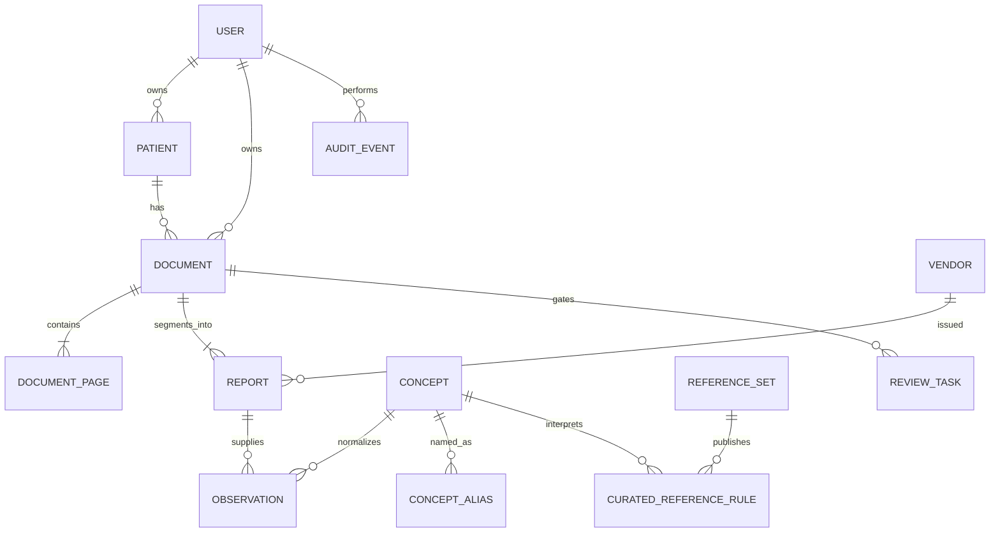

# Architecture

## Design goals

The data model is provenance-first, multi-user, and intentionally more granular than “one PDF equals one result.” It preserves raw vendor facts while allowing normalization and current guidance to evolve independently.

## Core boundaries

### Physical evidence

`documents` holds immutable source identity: owner, patient, file path, MIME type, byte size, SHA-256, page count, classifier output, and duplicate link. `document_pages` stores native text and OCR text in separate columns with extraction method and review state. This prevents OCR from silently replacing higher-quality native text.

### Logical reports

`reports` represents a report inside a physical document. An 18-page bundle can therefore contain several vendors, dates, and clinical types without falsifying the physical-file record. Each report has a page range and vendor.

### Clinical observations

`observations` stores raw name, typed value, comparator, raw/canonical units, observation date, the vendor's reference text and parsed bounds, page evidence, parser version, extraction method, confidence, and verification state. The original vendor interval is never replaced by a newer guideline.

### Semantic normalization

`concepts` is the canonical metric vocabulary. `concept_aliases` maps Ukrainian/English spelling, abbreviations, and vendor forms to a concept. Unmapped names remain first-class concepts in the `unmapped` category, so a parser never discards an otherwise valid result just because normalization is incomplete.

### Current guidance

`reference_sets` and `curated_reference_rules` are versioned, dated, sourced, and contextual. Rules can express decision limits or explicitly state that no universal numeric target exists. A band can be gated by facts the record holds (`requires`) and refused for facts the sample carries (`excludes`). They are rendered separately from vendor intervals to avoid presenting a laboratory interval as universal clinical guidance.

### Trust and audit

Every imported document has a `review_tasks` record. A review can verify all observations from the document or flag correction. Human correction updates the observation, marks `extraction_method=human_corrected`, and writes an `audit_events` entry. Exact duplicates are retained as evidence but contribute no duplicate observations.

### Diagnoses

`diagnoses.py` holds the person's diagnoses: an ICD-10 code (or the words written under it), status, certainty, dates and clinician, entered by hand or accepted from a document. The codes come from the catalogue bundled in `data/icd10.json` (read by `icd10.py`, built by `scripts/build_icd10.py`). Two readers propose diagnoses from documents and wait for the person to accept them: `diagnosis_candidates.py` reads the coded diagnoses in a consultation's text without a model, and `diagnosis_scan.py` reads the rest with the configured AI provider. `diagnosis_matrix.py` lists possible diagnoses that the results suggest; it only combines published bands from the reference library and never sets a threshold of its own. `web/diagnoses_job.py` re-checks the matrix in the background when the record changes. The assistant and the AI export read the recorded and possible diagnoses; neither ever counts a possible one as a diagnosis.

The reader of documents (`diagnosis_candidates.collect`) reads every narrative document, a study report included. Besides coded diagnoses it offers each statement of a conclusion word for word (`parse_conclusion`, candidates with method `text` and no code); statements that say nothing was found are dropped by word lists. The AI reader (`diagnosis_scan`) reads the same document types, and its reading of a document replaces that document's `text` candidates. `READER_VERSION` is part of the job's fingerprint, so a change of the reading rules makes every record be read again.

A diagnosis is titled by the catalogue in the reader's language (`diagnoses.display_name`). What the person or the document wrote beyond that title is `diagnoses.written_detail`, shown as "As written".

Medicines belong to a diagnosis through `diagnosis_treatment`: `GROUPS` maps groups of the WHO ATC classification to ICD-10 categories, and the table `diagnosis_medicines` holds the person's own word, a link (`linked` 1) or a refusal (`linked` 0), which wins over the group match. The page prints the reason for every match.

## Security model

- Passwords use salted `scrypt` hashes.
- Sessions are server-side, expire, and use HttpOnly/SameSite cookies.
- Every data query and mutation checks the authenticated `owner_user_id`.
- Mutations require a per-session CSRF token.
- Source downloads are resolved through an owned database record rather than a user-supplied path.
- SQLite foreign keys, WAL mode, indexes, and ordered migrations are enabled.
- Online backup: `anamna backup` (database, `secret.key`, originals).

For LAN or internet use, add TLS, set `ANAMNA_SECURE_COOKIES=1` when TLS terminates at a proxy, keep the `secret.key` that the server generates beside the database safe or set your own `ANAMNA_SECRET`, add backup encryption, and put the service behind a hardened reverse proxy. `anamna-web` binds to `127.0.0.1`; the container listens on all interfaces inside its own network namespace, so publish its port only to the proxy.

## Expansion paths

The current schema can be extended without weakening provenance:

- standardized coding: LOINC for observations, SNOMED CT/ICD for conditions, UCUM for units;
- encounters, practitioners, diagnoses, procedures, medications, prescriptions, allergies, and care plans;
- pathology specimens, microbiology organisms and susceptibility panels as structured domain tables;
- radiology narrative findings and DICOM studies/series/instances, storing bulk pixels outside SQLite;
- FHIR import/export while preserving the source resource and transform version;
- user-defined concept merges/splits, unit conversions, and rule authoring with approval history;
- encrypted backups, key rotation, retention policy, and append-only audit export;
- PostgreSQL/object storage when concurrent users or data volume outgrow local SQLite.

The key invariant should remain: normalized data is an interpretation layer; source evidence is never overwritten.
